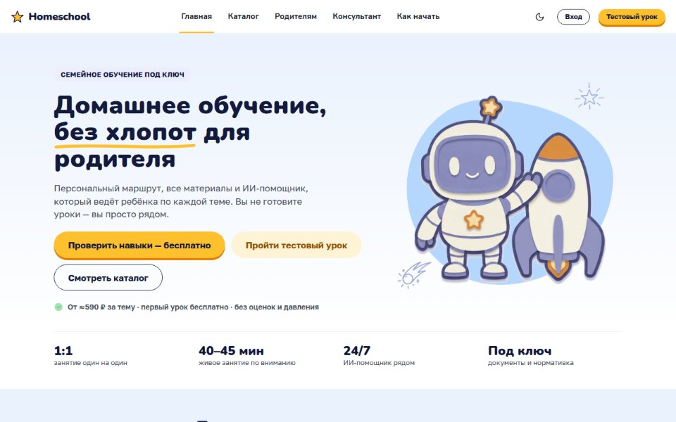
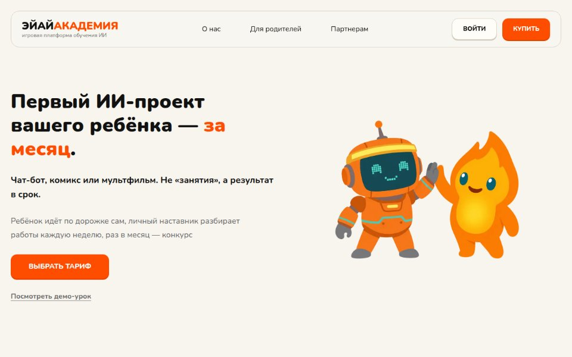
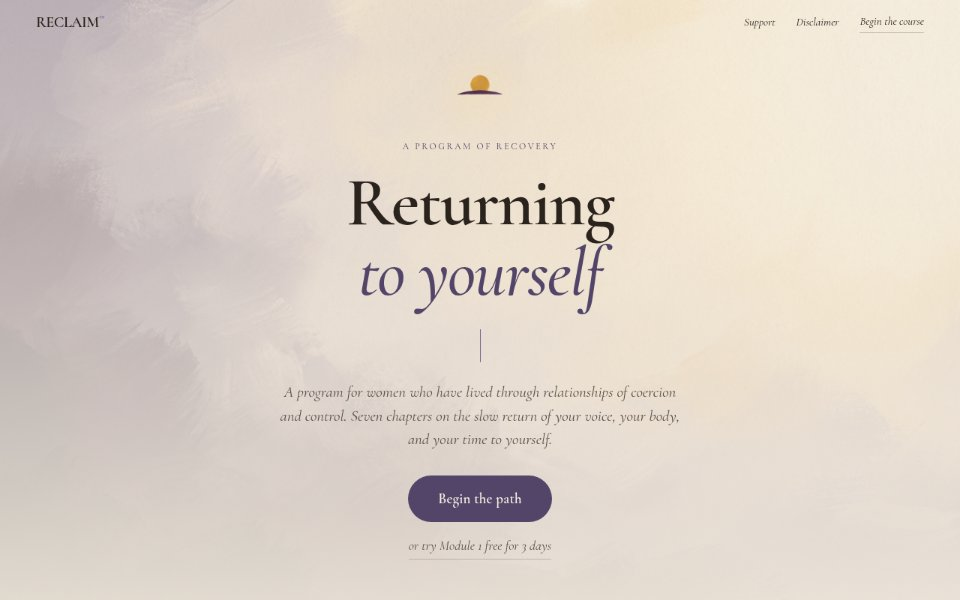
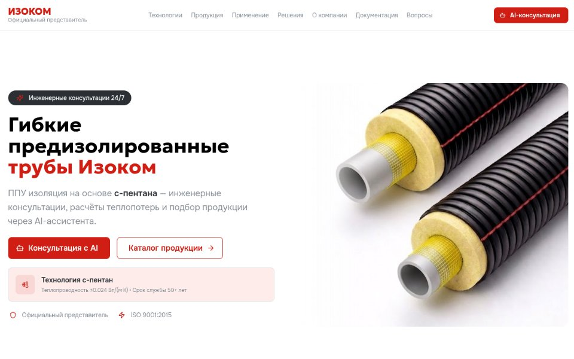

## Илья

### Проекты

<table>
<tr>
<td width="50%" valign="top">

<h3><a href="https://homeschool.bba-lab.ru">Homeschool</a></h3>
Голосовой AI-учитель для детей на семейном обучении: живой урок с ребёнком и кабинет родителя
  
React · TanStack · FastAPI · Kubernetes
</td>
<td width="50%" valign="top">

<h3><a href="https://bb-academy.ru">BB Academy</a></h3>
Игровая платформа: ребёнок за месяц делает свой AI-проект, наставник проверяет работы
  
Next.js · NestJS · PostgreSQL
</td>
</tr>
<tr>
<td width="50%" valign="top">

<h3><a href="https://reclaim-academy.com">Reclaim</a></h3>
Платформа курса психологического восстановления: видеокурс, сообщество и чат
  
Next.js · NestJS · Socket.IO
</td>
<td width="50%" valign="top">

<h3><a href="https://tk-gpi.ru">Изоком</a></h3>
Сайт производителя предизолированных труб с AI-консультантом по каталогу
  
RAG · FastAPI · Qdrant · React
</td>
</tr>
</table>

### Связь

Telegram [@ipqwq](https://t.me/ipqwq) · [asdymsk3@gmail.com](mailto:asdymsk3@gmail.com)
